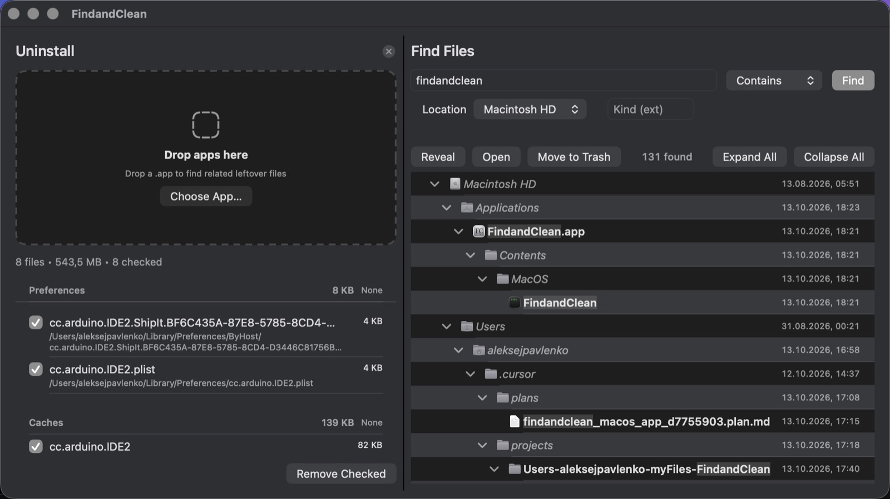

<p align="center">
  
</p>

<h1 align="center">FindandClean</h1>

<p align="center">
  <strong>Find Any File</strong>–style search + <strong>AppCleaner</strong>–style uninstall,<br>
  in one native macOS utility.
</p>

<p align="center">
  <a href="https://github.com/atomicFugas/FindandClean/releases/latest"></a>
  
  
</p>

<p align="center">
  
</p>

---

## Download

| | |
|---|---|
| **Installer** | [FindandClean-1.0.1.dmg](https://github.com/atomicFugas/FindandClean/releases/latest) |
| **Install** | Open the DMG → drag **FindandClean** into **Applications** |

> **Full Disk Access** is required for deep results (e.g. `~/Library/Biome`).  
> System Settings → Privacy & Security → Full Disk Access → enable FindandClean → quit & reopen.

---

## What it does

### Find Files
- Search by name (contains / starts with / equals / regex)
- Live results while scanning
- Foldable path tree with dates
- Reveal, Open, Move to Trash (selected item only — not recursive)

### Uninstall
- Drop a `.app` to open the dual pane
- Lists related leftovers (prefs, caches, containers, agents…)
- Check what to remove → Move to Trash

---

## Build from source

```bash
open FindandClean.xcodeproj
```

Or:

```bash
xcodebuild -scheme FindandClean -configuration Release build
```

---

## Safety

- Apple / SIP apps are blocked from leftover cleaning  
- Sensitive folders default unchecked and need confirmation  
- Volume roots refused  
- Trash only — no permanent delete in v1  

---

<p align="center">
  <sub>Made for macOS · not App Store / not sandboxed</sub>
</p>
